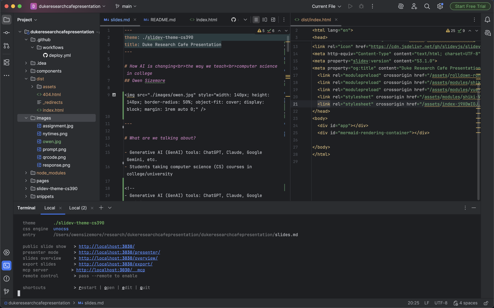
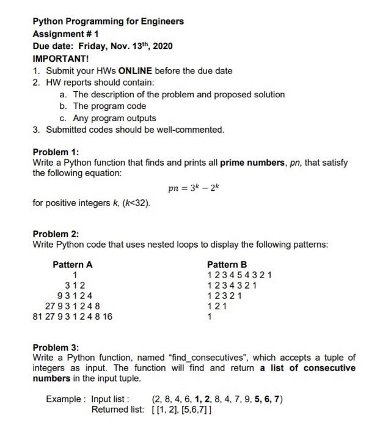
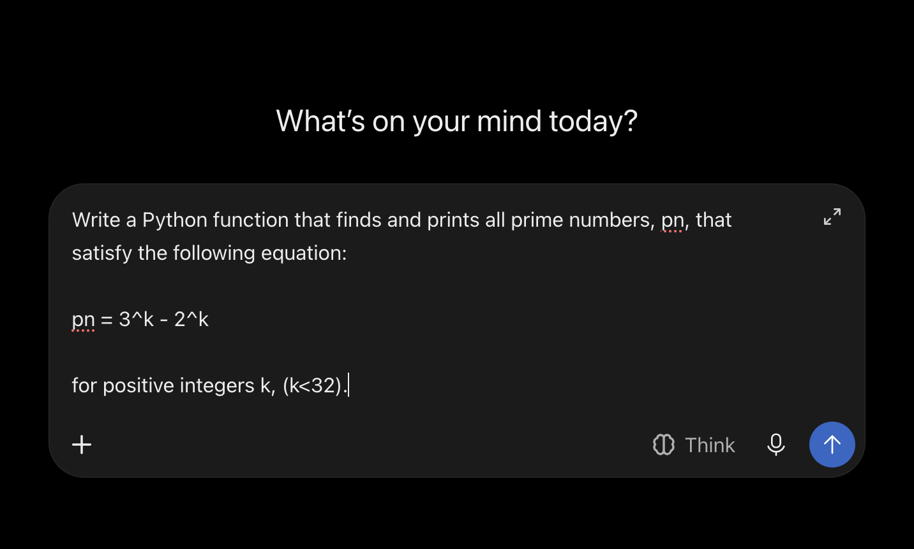
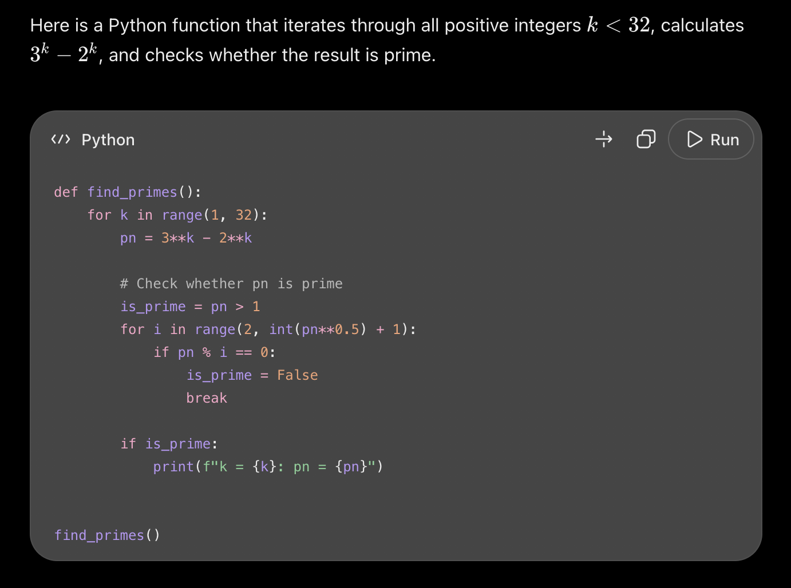
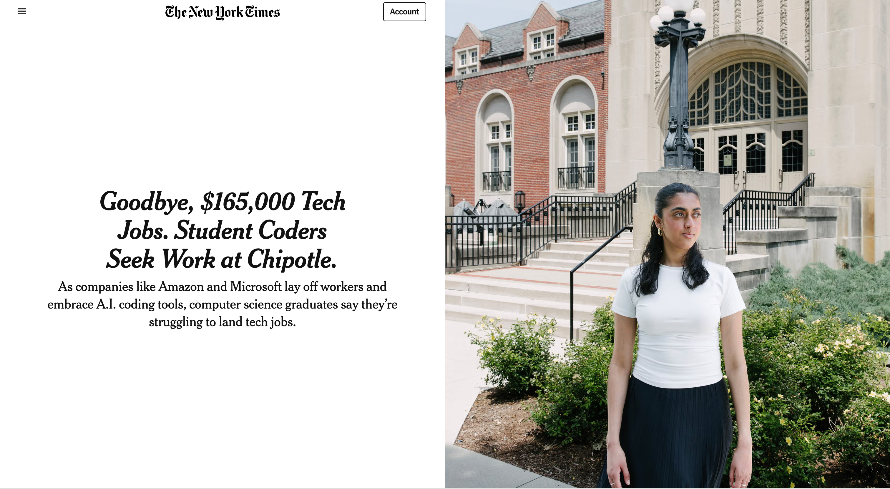

# How AI is changing the way we teach computer science in college
## Owen Sizemore

---

# What are we talking about?

- Generative AI (GenAI) tools: ChatGPT, Claude, Google Gemini, etc.
- Students taking computer science (CS) courses in college/university

<!--
- Generative AI (GenAI) tools: ChatGPT, Claude, Google Gemini, etc.
  - Mimic the natural language abilities of humans
  - Very good at producing code!
- Students taking computer science (CS) courses in college/university
  - Programming, software development, computer systems & architecture, theory
-->
---
layout: center
---

  

---

# What's the problem?

- GenAI is not designed to support learning
- Learners need friction to learn
- CS students use GenAI for instant answers

<!--
- GenAI is designed to provide information quickly and easily
  - It's a tool for productivity, not for learning
- Learners in all disciplines (not just CS) need friction to learn
- CS students (even well-meaning ones) use GenAI in a way that reduces friction, getting answers instantly and reducing opportunities for learning
-->
---
layout: center
---

  

    
    
Assignment

  

  
→

  

    
    
Prompt

  

  
→

  

    
    
Response

  

---

# What's the impact?

- Harder to measure learning
- Students (and instructors) are having less fun learning CS
- Declining enrollments, uncertain job outcomes

<!--
- Traditional programming assignments and assessments are no longer reliable indicators of learning
  - Less certainty that students are actually prepared for future courses + careers
- Students (and teaching staff) are having less fun learning CS
- Declining enrollments in CS courses and a rapidly-changing industry
-->
---
layout: center
---

---

# What do we do now?

- Don't ignore GenAI's impact on CS education
- Change course structure to encourage responsible GenAI use
- Still a lot of unknowns!

<!--
- Cannot ignore GenAI's impact on CS education
  - Don't ban it in classrooms - need reasonable boundaries
- Change course structure to encourage responsible GenAI use
  - New assignment types (oral assessments, writing on pen & paper, etc.)
  - Clear guidelines outlining productive & unproductive GenAI use
  - Assess learning early and often
- Still a lot of unknowns!
-->
---

# What am I researching?

- GenAI's impact on intro CS education
- Strategies to teach problem-solving & critical thinking skills in the "Age of AI"
- Curriculum updates to support responsible GenAI use

<!--
- The impact of GenAI on introductory-sequence CS education
  - first- and second-year students in CS101, CS201 courses
- Teaching students problem-solving and critical thinking skills in the "Age of AI"
- Designing new assignments and assessments to support responsible GenAI use
-->
---
layout: two-cols-header
autoClicks: false
---

# Summary

::left::

- GenAI tools reduce the friction needed for learning
- CS college courses are vulnerable to disruption by AI
- Courses must be adapted to meet current needs
- Students need proper instructional support to use AI responsibly
- My research explores the impact of AI on intro CS students and what to do about it

::right::

  
How AI is changing the way we teach computer science in college

  
  
<a href="mailto:owen.sizemore@duke.edu">owen.sizemore@duke.edu</a>

  
<a href="https://linkedin.com/in/owensizemore">https://linkedin.com/in/owensizemore</a>

<a href="https://owensizemore.github.io">owensizemore.github.io</a>

<!--
- GenAI tools reduce the friction needed for learning
- CS college courses are vulnerable to disruption by AI
- Courses must be adapted to meet current needs: changes to AI guidelines, assignments, assessments
- Students need to be given the instructional support to use AI responsibly
- My research seeks to understand the impact of AI on intro CS students and what to do about it
-->

